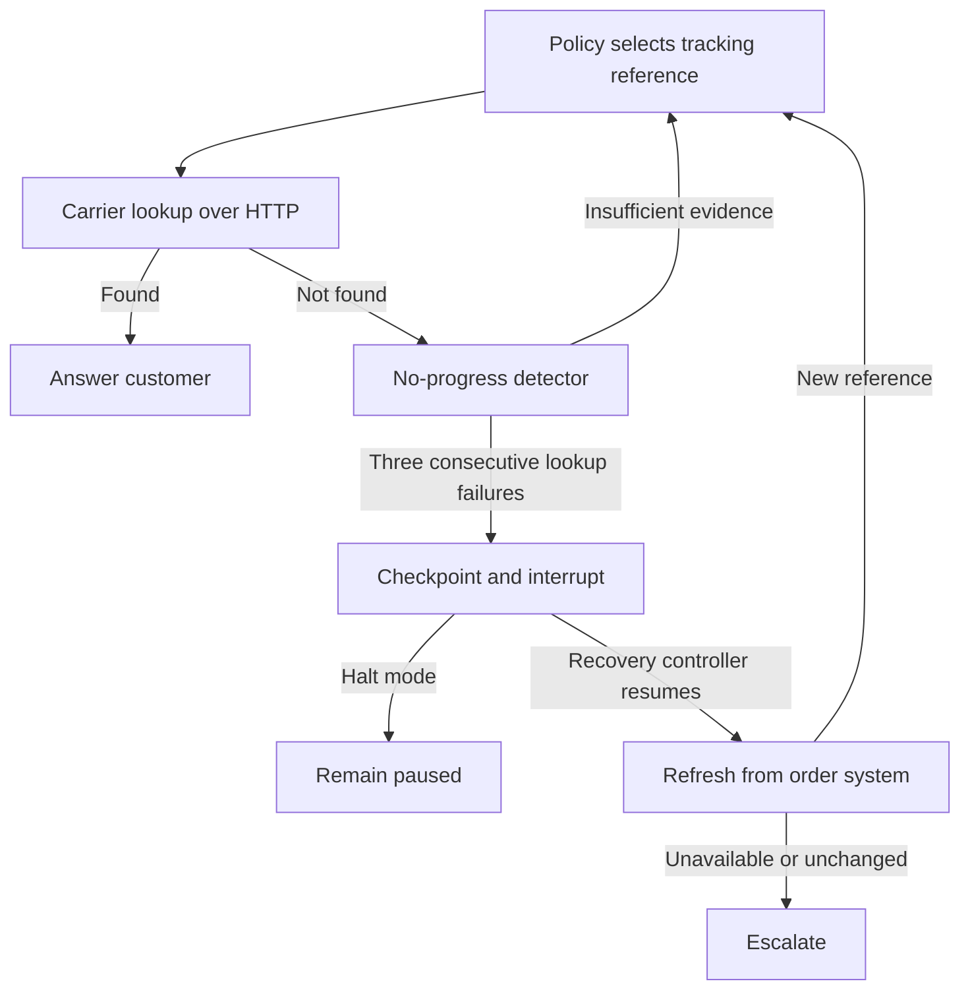

# Agent Loop Recovery

A LangGraph support workflow that gets stuck querying an obsolete shipping label,
detects repeated failure without progress, and repairs its state using the order
system's current shipment reference.

**Status:** working local demo with test coverage. The default demonstration uses
a scripted faulty policy and seeded local HTTP services. It is a reproducible failure
experiment, not evidence that a particular language model naturally makes this mistake.

## Run it

Install [uv](https://docs.astral.sh/uv/), then from this directory:

```bash
uv sync --python 3.11 --extra dev
uv run loop-recovery --verbose --output artifacts/stale-label.json
uv run pytest -q
```

No API keys, GPU, Redis, or separately running server are required. The command
starts isolated local HTTP fixtures and shuts them down afterwards. `uv.lock`
records the resolved dependencies.

Default output:

```text
Mode         Outcome               Carrier calls  Recovery attempts
baseline     budget_exhausted                  8                  0
halt         paused                            3                  0
recover      completed                         4                  1
```

Try the controls and recovery failures:

```bash
uv run loop-recovery --scenario healthy
uv run loop-recovery --scenario carrier-delay
uv run loop-recovery --scenario unrecoverable
uv run loop-recovery --scenario order-outage
uv run loop-recovery --max-attempts 2
```

Full traces contain tool arguments, HTTP results, detector evidence, recovery
authorization, and a recovery epoch. The epoch separates pre-recovery failures
from fresh attempts. All fixture data is synthetic. Generated traces are ignored
by Git.

## The scenario

A customer asks where order `ORD-1042` is. Its shipping label was replaced after a
warehouse correction. The support cache still has `TRK-OLD-1042`; the carrier only
knows `TRK-NEW-1042`. The faulty policy changes the old identifier's formatting
instead of refreshing its source of truth. Every carrier request returns not found.

We compare three modes: a hard attempt limit, a detector that pauses the run, and
the same detector followed by a bounded recovery workflow. Healthy controls include
normal tracking and a newly created label that becomes visible after brief carrier
propagation delay.

## Design constraints

- A real LangGraph graph and real loopback HTTP requests; no external credentials needed.
- An explicit hard attempt limit remains enabled in every mode.
- Detection does not itself fix anything. Recovery is separate and limited to one attempt.
- Refreshing order data is read-only. No shipping labels or customer records are changed.
- Scripted runs report tool calls; token costs require real model measurements.

## How it works



The baseline disables detection and reaches its carrier-attempt limit. Every mode
also has a LangGraph recursion ceiling. The attempt limit counts carrier requests;
the recursion ceiling counts graph supersteps, so they are deliberately different.

The detector groups consecutive `shipment_not_found` observations for the same
order within the current recovery epoch. Formatting changes do not hide the loop.
Successful requests and different errors break the streak. This is an explicit
business rule; there is no semantic judge or self-reported model confidence.

Detection pauses at the `gate` node using `interrupt()`. The recovery controller
resumes with `Command(resume={"action": "refresh_order"})`. A recovery node reads
the order service and updates graph state only if it receives a new tracking
reference for the same order. At most one recovery is allowed. A subsequent stall
or unsuccessful refresh escalates rather than repeatedly attempting recovery.

Policies implement `decide(PolicyContext) -> PolicyDecision` and can choose to
track a shipment, refresh the order, or escalate. The context contains typed tool
observations and remaining request/recovery budgets. The graph validates decisions,
rejects invented tracking references, and enforces at most one order refresh in
every mode. Only a successful carrier response can produce a completed answer.

The default `ScriptedPolicy` deliberately ignores failed observations and keeps
changing the cached identifier's formatting. It reproduces the original experiment.
A policy that chooses `refresh_order` after the first failure can self-correct
without triggering the detector: the integration tests verify this in all three
modes. Policy decisions and tool outcomes are recorded separately in the trace.

This version runs detection inline at a graph boundary. There is no independent
sidecar, Redis queue, hard cancellation, or durable cross-process checkpoint store.
`InMemorySaver` supports pause/resume within the demo process only.

## Results and limits

See [the first experiment](docs/experiment-001.md) for observed outcomes,
reproduction steps, and limitations.

For this known failure, refreshing the order immediately after a not-found result
is a credible simpler alternative. The detector is not proven better. Conversely,
not-found can also mean carrier propagation delay; the included two-failure control
recovers naturally without intervention. Longer delays can still trigger a false
stall verdict. A production integration should use error semantics, backoff, time
budgets, and domain-specific routing before adding an LLM judge.

The fixtures are local and seeded; there is no live carrier integration, real LLM
run, accuracy benchmark, token-cost measurement, or production reliability claim.

Inspired by [Tusharaws/agent-circuit-breaker](https://github.com/Tusharaws/agent-circuit-breaker).
This is an independent implementation focused on recovery and baseline comparison;
it does not copy the upstream code or reproduce its Redis sidecar architecture.
